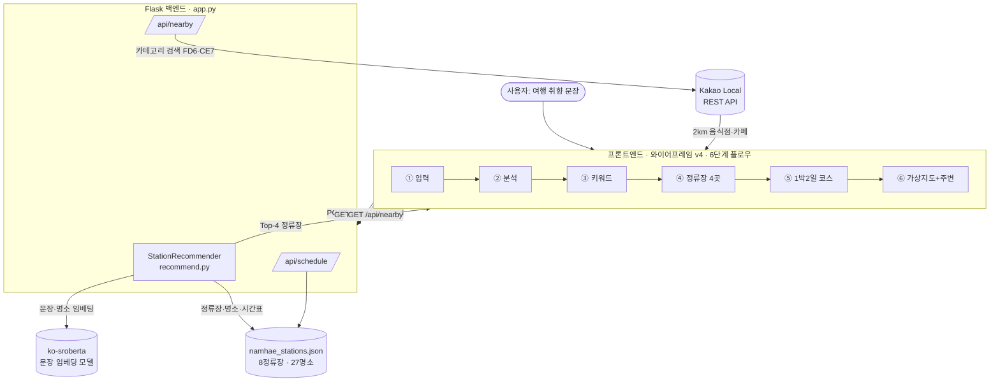
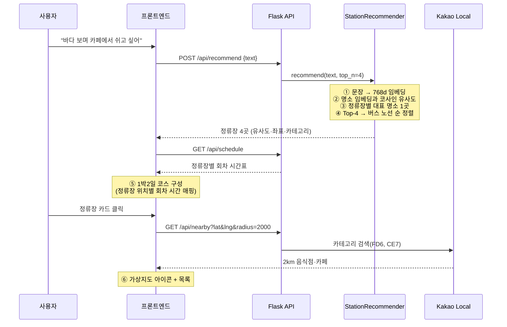

# 남해 뚜벅이버스 — 서비스 아키텍처 & 파이프라인

> **한 줄 소개**
> 여행 취향을 한 문장으로 적으면, **남해 뚜벅이버스 정류장**을 AI가 골라 **1박 2일 버스 코스**로 묶어주고, 각 정류장 2km 안의 **맛집·카페까지 지도에** 찍어주는 뚜벅이 여행 플래너.

---

## 1. 문제 정의

- 남해는 명소가 흩어져 있고 **대중교통(뚜벅이버스)** 배차가 적어, 차 없는 여행자는 동선·시간표 짜기가 어렵다.
- 기존 추천 서비스는 "키워드 검색" 위주라 **"천천히 바다 보며 카페에서 쉬고 싶어" 같은 자연어 취향**을 못 받는다.

**→ 자연어 취향 → 정류장 추천 → 버스 시간표 기반 코스 → 주변 먹거리**까지 한 흐름으로 잇는다.

---

## 2. 시스템 아키텍처 (Figure)



### ASCII 버전

```
┌──────────────────────────────────────────────────────────────┐
│                      브라우저 (Frontend)                        │
│   index.html · main.js · style.css   (와이어프레임 v4)          │
│   ① 입력 → ② 분석 → ③ 키워드 → ④ 정류장4곳 → ⑤ 1박2일 → ⑥ 지도  │
└──────────┬────────────────────┬───────────────────┬────────────┘
   POST /api/recommend   GET /api/schedule    GET /api/nearby
           ▼                    ▼                   ▼
┌──────────────────────────────────────────────────────────────┐
│                    Flask 백엔드 (app.py)                        │
│   /api/recommend   /api/schedule   /api/nearby   /api/health    │
└────┬───────────────────┬────────────────────────┬─────────────┘
     ▼                    ▼                        ▼
StationRecommender   namhae_stations.json    Kakao Local REST API
(recommend.py)       8 정류장 / 27 명소        (FD6 음식점, CE7 카페)
 · ko-sroberta 임베딩  정류장별 회차 시간표      반경 2km 검색
 · 코사인 유사도 Top-4
 · 키워드 폴백
```

---

## 3. 추천 파이프라인 (Pipeline)



### 단계별 설명

| 단계 | 처리 | 위치 |
|------|------|------|
| **① 임베딩** | 사용자 문장을 `ko-sroberta-multitask`로 768차원 벡터화 | `recommend.py:_embed_scores` |
| **② 유사도** | 서버 시작 시 미리 계산해 둔 27개 명소 임베딩과 코사인 유사도 | `recommend.py` (normalize 후 내적) |
| **③ 대표 명소** | 정류장마다 유사도 최고 명소 1곳만 대표로 선택 | `recommend.py:recommend` |
| **④ 코스 정렬** | 상위 4개 정류장을 뽑고 **버스 노선 운행 순서**로 정렬 | `recommend.py` (stop_order) |
| **⑤ 시간표 매핑** | 정류장 위치별로 탑승 회차 매핑 (1일차 2·3회차 / 2일차 1·2회차), **각 정류장 고유 schedule**에서 정확한 시각 추출 | `main.js:boardInfo` |
| **⑥ 주변 탐색** | 정류장 좌표 기준 Kakao Local 2km 음식점·카페 검색 → 가상지도 아이콘 + 목록 | `app.py:kakao_nearby`, `main.js:renderFakeMap` |

> **폴백 설계**: 임베딩 모델 로드 실패 시 `recommend.py`가 자동으로 **키워드 사전 기반 이진 코사인**으로 동작 → 인터넷/모델 없이도 추천이 끊기지 않음.

---

## 4. 기술 스택

| 레이어 | 기술 |
|--------|------|
| 프론트엔드 | HTML/CSS/Vanilla JS (SPA식 6단계 플로우), Tabler Icons, Google Fonts(Jua/고운돋움) |
| 백엔드 | Python **Flask** |
| AI/추천 | **sentence-transformers** `jhgan/ko-sroberta-multitask` 문장 임베딩 + 코사인 유사도 (폴백: 키워드 사전) |
| 외부 API | **Kakao Local REST API** (카테고리 검색) |
| 데이터 | 정적 JSON (`namhae_stations.json`) — 8정류장·27명소·정류장별 버스 회차 시간표 |

---

## 5. 핵심 기능 & 차별점

1. **자연어 취향 입력** — 키워드가 아닌 "한 문장"으로 여행 느낌을 받음 (문장 임베딩 기반).
2. **대중교통 제약을 코스에 반영** — 단순 명소 나열이 아니라, 정류장을 **버스 운행 순서 + 회차 시간표**로 묶어 실제로 탈 수 있는 1박2일 동선으로 변환.
3. **정류장 단위 주변 탐색** — 각 정류장 2km 내 실제 맛집·카페를 Kakao Local로 끌어와 지도에 표시.
4. **오프라인/폴백 견고성** — 모델·네트워크가 없어도 키워드 폴백으로 동작.

---

## 6. API 명세 (요약)

| 메서드 | 경로 | 입력 | 출력 |
|--------|------|------|------|
| POST | `/api/recommend` | `{ "text": "..." }` | 추천 정류장 4곳 (유사도·좌표·카테고리·설명) |
| GET | `/api/nearby` | `?lat=&lng=&radius=2000` | 반경 내 음식점·카페 목록 |
| GET | `/api/schedule` | — | 정류장별 회차 시간표 |
| GET | `/api/health` | — | 엔진 종류·키 로드·명소 수 |
